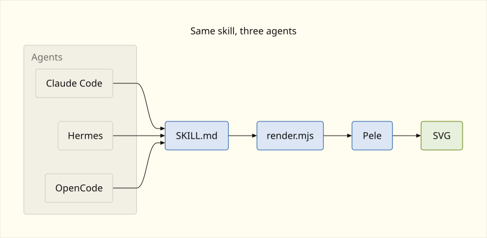
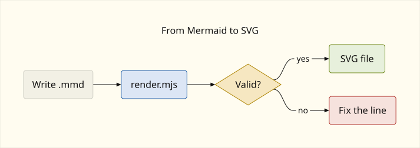
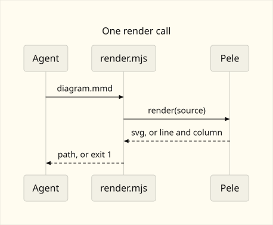
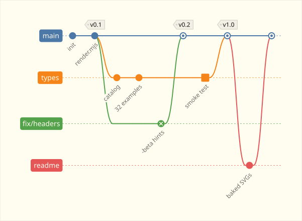
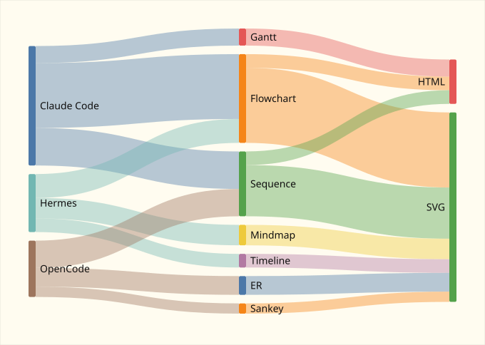
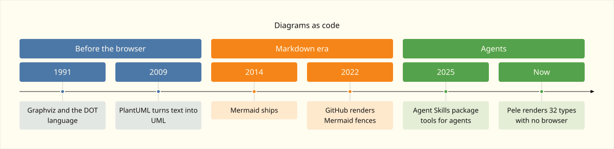
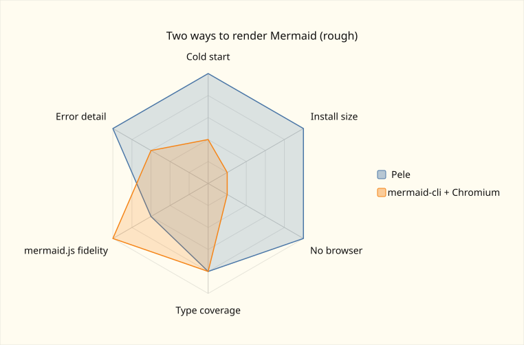
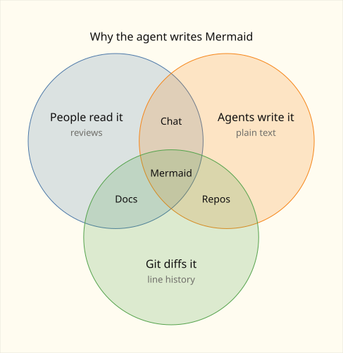

# pele-skill

Agent skill that renders [Mermaid](https://mermaid.js.org/) diagrams to SVG with [Pele](https://github.com/obsidianmd/pele). Pele is a small synchronous renderer: no browser, no Puppeteer, no runtime dependencies of its own.

This repository is the skill. It is not the Pele library. The installable directory is `skills/pele/`. It follows the [Agent Skills](https://agentskills.io/) layout, so the same folder loads in Claude Code, Hermes Agent, and OpenCode.

The figures below are Pele output, not mockups. Source is in `skills/pele/examples/readme/`.

<p align="center">
  
</p>

Same skill. Three agents load `SKILL.md`, call `render.mjs`, and get an SVG.

<p align="center">
  
</p>

Write a `.mmd` file, render it, and branch on the result. Green is a file. Red is a line to fix.

<p align="center">
  
</p>

One call. Pele returns an SVG, or the line and column of the syntax error.

## Beyond flowcharts

Flowcharts and sequences are a small part of the 32 types. These five come from the same skill, and their sources are in the same folder.

<p align="center">
  
</p>

`gitGraph`: branches, merges, tags, and highlighted or reverted commits.

<p align="center">
  
</p>

`sankey`: weighted flows from three CSV columns.

<p align="center">
  
</p>

`timeline`: dated events grouped into sections.

<p align="center">
  
</p>

`radar-beta`: series compared on shared axes. mermaid-cli wins on fidelity because it is mermaid.js.

<p align="center">
  
</p>

`venn-beta`: overlapping sets with labeled intersections.

## Requirements

- Node.js 20 or newer
- npm
- No Chromium and no Python

The script installs `pele@1.6.0` into the skill directory on first run if `node_modules/pele` is missing. Install it yourself with `npm install` inside `skills/pele/` (or inside the installed skill folder). Do not install it into the project you are diagramming.

## Install

After this repo is on GitHub, one command covers the three agents:

```bash
npx skills add jpmanson/pele-skill --skill pele -a claude-code -a hermes-agent -a opencode -g -y
```

From a local clone, point `skills` at the repo instead of the GitHub slug:

```bash
npx skills add /path/to/pele-skill --skill pele -a claude-code -a hermes-agent -a opencode -g -y
```

`-g` installs for every project. Omit it to install into the current project only. Drop `-y` if you want the prompts. Add `--copy` when the target cannot use symlinks.

That command writes one canonical copy and links the agents at it:

| What | Path |
|---|---|
| Canonical copy, also read by OpenCode | `~/.agents/skills/pele/` |
| Claude Code symlink | `~/.claude/skills/pele/` |
| Hermes Agent symlink | `~/.hermes/skills/pele/` |

OpenCode discovers `~/.agents/skills/<name>/SKILL.md` on its own, so a global install does not also create `~/.config/opencode/skills/pele/`. Project installs use `.claude/skills/`, `.hermes/skills/`, and `.agents/skills/` in the repo you are working in.

Update later with:

```bash
npx skills update pele -g -y
```

Manual install, if you cannot run `npx skills`: copy or symlink `skills/pele/` to one path in the table. The directory name must stay `pele`, because that is the `name` in `SKILL.md`.

Start a new agent session after installing. A session that is already open does not reload its skill list.

### Per agent

Claude Code loads `~/.claude/skills/pele/SKILL.md` and exposes it as `/pele`.

Hermes Agent loads any `SKILL.md` under `~/.hermes/skills/`, including the symlink at `~/.hermes/skills/pele/SKILL.md`. The frontmatter `name` is `pele`. Hermes shows the start of `description` in its skill index, which is why that field opens with "Use when rendering Mermaid to SVG."

OpenCode loads `~/.agents/skills/pele/SKILL.md` (global) and `.agents/skills/pele/SKILL.md` (project). It also searches `~/.config/opencode/skills/` and `.opencode/skills/` if you put a copy there yourself. `metadata.opencode/slash` is `"true"`, so the TUI can invoke it as `/pele`.

## Use

Write Mermaid to a file, then render from the skill directory:

```bash
cd skills/pele   # or the installed skill folder
node scripts/render.mjs examples/flowchart.mmd /tmp/flowchart.svg
node scripts/render.mjs --html examples/sequence.mmd /tmp/sequence.html
```

SVG (or HTML) goes to the output path. A one-line JSON receipt goes to stderr:

```json
{"ok":true,"type":"flowchart","width":180,"height":80,"bytes":1200,"output":"/tmp/flowchart.svg","html":false,"pele":"1.6.0"}
```

A syntax error exits 1 and names the line:

```json
{"ok":false,"code":"syntax","line":2,"column":5,"snippet":"..."}
```

`--check` only loads Pele and prints its version. `--types` prints every supported type with its exact header and an example path. `npm run smoke` renders one example per type, checks the catalog against Pele's type list, and asserts that `examples/broken.mmd` still fails.

Agents should follow `skills/pele/SKILL.md`: write a `.mmd` file, run the script, fix `syntax` / `semantic` errors from the receipt, and hand back the absolute path. They should not call mermaid-cli and should not add an MCP server for this.

The README figures are a separate export. `render.mjs` keeps CSS variables so a host page can theme the SVG. `scripts/export-readme.mjs` bakes a paper palette into literal colors, because GitHub drops `var(--pele-*)` and the diagram would render blank.

## Layout

```text
skills/pele/
  SKILL.md                 # instructions the agent loads
  package.json             # pins pele@1.6.0
  scripts/render.mjs       # Mermaid file -> SVG or HTML; --types lists the 32 types
  scripts/catalog.mjs      # type, exact header, and use for each type
  scripts/export-readme.mjs
  scripts/smoke.mjs
  examples/                # flowchart, sequence, one broken source
  examples/types/          # one working source per diagram type
  examples/readme/         # sources for the figures above
  references/diagram-types.md
docs/images/               # baked SVGs embedded in this README
```

## Development

```bash
cd skills/pele
npm install
npm run smoke
npm run readme
```

`npm run smoke` must exit 0. It renders `examples/flowchart.mmd` and `examples/sequence.mmd`, checks an HTML wrap, strips a markdown fence from stdin, and requires `examples/broken.mmd` to fail with `code: "syntax"`.

`npm run readme` rewrites `docs/images/*.svg` from `examples/readme/`. Commit both the sources and the SVGs.

CI runs the smoke command on Node 22 (`.github/workflows/check.yml`).

Pele targets Mermaid 12.1.0 syntax and uses its own layout. A render that exits 0 is valid Pele output, not a promise that it matches mermaid.js pixel for pixel. In Node, text is measured with Pele's width table rather than canvas.

## License

MIT. See [LICENSE](LICENSE).

Pele itself is also MIT, copyright its authors, and is consumed as the `pele` npm package. It is not vendored here.
